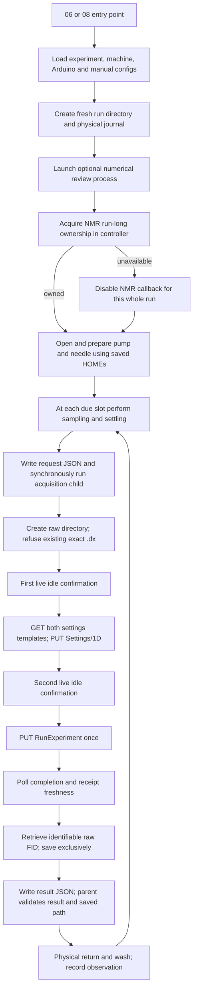

# NMR acquisition blocker audit and simplification plan

Audit date: **2026-10-20, America/Indianapolis**. Source revision:
`601ef2d5af4c5a529161ab5c4decbc4bde3e4f6e`.

**Investigation and planning only. No production code, acquisition settings,
timing, Chemyx behavior, Arduino behavior or historical experiment data was
changed.** All execution used HOME, fake transports, mock instruments or
read-only configuration loading. WORK and the physical instruments were not
contacted. Proposed behavior below is not implemented.

## 1. Executive summary

The reported `RuntimeError: NMR idle not confirmed; START skipped to avoid
overlap` means the **first live status check did not establish idle**. The
worker did not send START or change NMR settings in that attempt. The error
alone cannot distinguish an actually busy instrument, an unsupported status
representation, or a failed network/status request. The missing response from
WORK prevents identifying a single root cause.

There is no persisted NMR acknowledgment/reconciliation JSON that must be
cleared to authorize another run. The idle evidence is a live HTTP response.
Current request/result sidecars are IPC and diagnostics, with real filesystem
failure modes; old ordinary reports and analysis JSON are not START gates.

The core acquisition engine is **already shared by 06, 08 and 04's NMR check**.
The strongest findings are specific defects and inconsistent paths, rather
than evidence that all validation should be removed:

- **P0, demonstrated offline:** an acquisition child can survive controller
  death, lose the controller's ownership protection and issue START while a
  replacement process owns the same OS lock.
- **P1, demonstrated:** the immediately-before-START receipt is recorded but
  not used as the completion freshness baseline. A stale acquisition can be
  labelled `NMR_SAVED` after setup changes the last receipt.
- **P1, demonstrated:** an unknown nonzero status code counts as positive
  running evidence after START. A later idle reply without any receipt can
  therefore falsely satisfy the alternate completion-freshness condition.
- **P1, demonstrated:** valid JSON with leading whitespace and `text/plain`
  content type is returned as a string and fails the strict idle parser.
- **P1, demonstrated:** unsupported status structure and earlier read errors
  disappear from diagnostics; the user can be left with only `{}`.
- **P1, demonstrated/source-confirmed:** a transient initial ownership failure
  disables NMR for the entire run; the controller can report `COMPLETE` with
  zero spectra. A simulated valid acquisition can also exceed the parent's
  heuristic 430-second budget while satisfying its inner phase logic.
- **Evidence-dependent:** percentage/code precedence, nested/string status
  values and receipt formatting may reject real hardware responses. HOME has
  no real idle-status capture establishing those semantics. Do not broaden
  permission to START by guessing them.

Retain ownership, both idle checks initially, one START maximum, a killable
acquisition process, receipt/data attribution and exclusive data writes.
Fix demonstrable defects first, then consolidate duplicated controllers and
legacy acquisition routes. Keep numerical analysis outside instrument control.

## 2. Actual architecture and configuration

### Source map

All line references below refer to the audited revision, before changes.

| Name | Actual file and relevant functions |
|---|---|
| 06 entry | [C:/code/chemyx_pump/scripts/06_si6_stage2only_run.py:3](C:/code/chemyx_pump/scripts/06_si6_stage2only_run.py:3) imports the 06 controller's `main` |
| 08 entry | [C:/code/chemyx_pump/scripts/08_si6_stage2only_scipy_run.py:3](C:/code/chemyx_pump/scripts/08_si6_stage2only_scipy_run.py:3) imports the SciPy controller's `main` |
| C06 | [C:/code/chemyx_pump/chemyx_lab/workflows/si6_stage2only.py:41](C:/code/chemyx_pump/chemyx_lab/workflows/si6_stage2only.py:41): `load_settings`, `Stage2OnlyRig`, `run_stage2only`, `start_review_worker`, `run`, `main` |
| C08 | [C:/code/chemyx_pump/chemyx_lab/workflows/si6_stage2only_scipy.py:43](C:/code/chemyx_pump/chemyx_lab/workflows/si6_stage2only_scipy.py:43): equivalent functions with different defaults/review worker |
| F | [C:/code/chemyx_pump/chemyx_lab/workflows/si6_fixed_time.py:301](C:/code/chemyx_pump/chemyx_lab/workflows/si6_fixed_time.py:301): shared `Rig.sample`; `nmr_check` at 581 |
| N | [C:/code/chemyx_pump/chemyx_lab/workflows/si6_fixed_time_nmr.py:22](C:/code/chemyx_pump/chemyx_lab/workflows/si6_fixed_time_nmr.py:22): `running_state`, `confirm_idle`, `acquire`, `acquire_bounded`, child `main` |
| D | [C:/code/chemyx_pump/chemyx_lab/instruments/nmr.py:52](C:/code/chemyx_pump/chemyx_lab/instruments/nmr.py:52): HTTP `_request`, iFlow methods, template builders and legacy waiter/parser |
| L | [C:/code/chemyx_pump/arduino/python/run_lock.py:12](C:/code/chemyx_pump/arduino/python/run_lock.py:12): `PortProcessLock` |
| B | [C:/code/chemyx_pump/chemyx_lab/workflows/si6_automated_nmr.py:744](C:/code/chemyx_pump/chemyx_lab/workflows/si6_automated_nmr.py:744): `build_instrument_settings` |
| CFG | [C:/code/chemyx_pump/chemyx_lab/config.py:277](C:/code/chemyx_pump/chemyx_lab/config.py:277): machine loading, explicit environment overrides at 446, `load_nmr_settings` at 729, coercion at 808 |

The aliases C06/C08/F/N/D/L/B/CFG in the inventory identify these actual paths.

### Verified call flow



Failure branches from W through V return an observation-level `NMR_FAILED`
or `NMR_MISSING`, then physical cleanup and scheduling continue. The disabled
callback skips W through V. Required physical-state, pump, needle or journal
failures can stop the experiment; NMR/analysis failure does not authorize
ignoring those requirements. Numerical review never supplies START permission.

| Step/function | Required input and failure behavior |
|---|---|
| C06 `main:325`, `load_settings:41`; C08 `main:327`, `load_settings:43` | Parse modes and preset, validate recipe/configuration. Failure prevents startup. `--mock` contacts no instrument; `--validate-config` only validates. |
| C06 `run:188–241`; C08 `run:190–243` | Fresh output directory and required physical journal; optional report/review files have exception boundaries. Launching the review worker is not a prerequisite. |
| C06 `run:251–258`; C08 `run:253–260`; L `acquire:19` | Local nonblocking OS lock keyed by `fixed-nmr:<host>:<port>`. Failure installs a permanent failing NMR callback for this invocation. |
| C06 `run_stage2only:120–160`; F `Rig.sample:301–333` | At the scheduled cycle, withdraw liquid, move to saved HOME, withdraw, settle, then call acquisition. Physical errors before this point mean no NMR call. |
| N `acquire_bounded:254–278`, child `main:281–289` | Serialize effective settings/path/retrieval wait; launch same Python executable; read request; execute acquisition; write reply. Process/IPC failures become NMR failure. |
| N `acquire:144–155`, `confirm_idle:123–139` | Fresh exact raw destination; recognized live idle. No START or settings change on first idle refusal. |
| N `acquire:156–164`; D template builders at 260/278 | GET `/iFlow/Settings/1D`, GET `/iFlow/ExperimentSettings`, patch copies, PUT `/iFlow/Settings/1D`, confirm idle again. Failures prevent START. |
| N `acquire:165–206`; D `run_iflow_experiment:155` | Mark dispatch attempted, PUT `/iFlow/RunExperiment` once; poll for completion with fresh identity or running-to-idle evidence. Dispatch exception is uncertain, never automatically replayed. |
| N `acquire:207–251`, `raw_text:96`, `local_fid:118` | Retrieve/save raw FID; preserve partial/foreign files. Missing payload becomes `NMR_MISSING`; I/O/protocol exceptions become `NMR_FAILED`. |
| N `acquire_bounded:267–278`; C06 `observe:212–223` | Validate child exit/result and exact nonempty saved path, export outcome, finish physical cleanup and continue schedule. |

Both controllers import the **same function object** `acquire_bounded` as
F. Offline AST inspection also verified their settings loaders and schedulers
are identical. Their meaningful differences are default preset/output root,
run identity, report label/primary area method and independent numerical review
worker. 06 uses the original review processor; 08 uses ACME/ALS and the approved
8σ prominence/width-0.95 dynamic primary area. Those processing differences do
not change acquisition status, ownership, scans or timing.

### Configuration precedence and present equivalence

- [06 preset](C:/code/chemyx_pump/configs/experiments/si6_stage2only_6h.yaml)
  or [08 preset](C:/code/chemyx_pump/configs/experiments/si6_stage2only_scipy_6h.yaml)
  supplies route, eight scans, gain, auto gain, center, width and result type.
- The selected [machine YAML](C:/code/chemyx_pump/configs/machines/si6_real_COM4.yaml)
  supplies host/port/scheme, HTTP timeout, poll interval and acquisition limit.
  COM6 changes the pump endpoint; the current NMR endpoint is the same.
- B `build_instrument_settings:744–771` applies explicit process-environment
  overrides after YAML. `NMR_HOST`, `NMR_PORT`, scheme/timeouts, route/gain/
  center/width can override YAML. Acquisition-only loading intentionally ignores
  `NMR_DEFAULT_SCANS` and `NMR_TARGET_PPM`; the eight-scan preset wins.
- `load_nmr_settings(load_local=False)` skips legacy
  `configs/nmr.local.json`. The inspected bootstrap/config path does not itself
  load a `.env` file; variables must actually be in the process environment.
- Missing machine files can return default/empty machine settings rather than
  fail immediately (CFG `load_machine_config:277–289`). Invalid YAML/types,
  unsupported routes/result types or nonpositive deadlines can stop startup;
  absent/wrong endpoints can instead fail during HTTP requests. Current
  validation does not prove a live endpoint or valid server-side settings.
- `configuration.json` stores the raw preset, not the full effective machine/
  environment resolution. Each acquisition request currently records the
  effective `NmrSettings`. A summary should expose both values and their sources.

Current HOME resolution of 06, 08 and `04 --nmr-check` was equal:
HTTP `169.254.30.54:5000`, timeout **10 s**, poll **2 s**, completion allowance
**300 s**, retrieval **20 s**, **8 scans**, gain **12**, auto gain **false**,
center **5 ppm**, width **20 ppm**, iFlow raw FID. These are configuration facts,
not evidence that the endpoint is reachable or those values are accepted on WORK.

`04 --nmr-check` loads the full two-stage preset first (F `main:629`) and
then calls F `nmr_check:581–611`. It therefore also requires unrelated config
files to parse, although it opens no pump/needle/dose state. It cannot take a
stage2only preset directly because the schemas differ. Today's settings match;
future drift is possible. The check retains its existing typed `y/yes` prompt,
fresh output-directory requirement, same ownership lock and same worker.

## 3. Complete blocker inventory

Priorities: **P0** ownership/safety correctness; **P1** measurement loss,
wrong attribution or essential diagnosis; **P2** hardening/maintainability.
“Blocks START?” concerns this observation, not whether the timed run continues.
“Recoverable” does not authorize reissuing an uncertain START.

| Blocker | File/function | Trigger | Blocks START? | Recoverable? | Proposed action |
|---|---|---|---|---|---|
| B01 Configuration/import/bootstrap failure | C06 `main:325`, `load_settings:41`; C08 equivalents; B `:744`; CFG `:277,446,729,808` | Missing/invalid preset/dependency, unsupported route/FID settings, invalid numeric values, erroneous environment override | Yes; can prevent whole startup | Correct inputs before launch | Validate/log effective acquisition config once; retain recipe/HOME validation |
| B02 Wrong endpoint or unavailable HTTP service | D `_request:52–84` | Wrong host/port/scheme/path, refused connection, DNS/URL error, HTTP 4xx/5xx, socket/read timeout | Yes before START; later can lose completion/data | Read-only retries; no uncertain START retry | Phase-specific network errors and bounded policy |
| B03 Lock unavailable | C06 `run:251–258`; C08 `:253–260`; L `acquire:19–43` | Active participating owner, permissions, directory/open/OS-lock error | Yes, every observation in this invocation | Currently no reacquisition; later run may recover | P1: keep ownership; permit bounded later reacquisition only while START is known unsent |
| B04 Existing run/check directory | C06 `run:190`; C08 `:192`; F `nmr_check:594` | Explicit output directory already exists | Yes; startup stops | Use a genuinely new destination | Retain no-overwrite rule and unique identities |
| B05 Output/request creation failure | N `acquire_bounded:257–263`; `acquire:146–147` | Bad path, permissions, disk full, parent is a file, serialization/write failure | Yes if before child/START | Fix storage; next observation can attempt | Operation-specific filesystem diagnostics; reduce IPC writes later |
| B06 Child cannot start/read request | N `acquire_bounded:264–267`; `main:286–288` | Python/module/import failure, invalid/truncated request, launch error | Yes if child never dispatches | Next observation; repair environment | Keep isolation, explicit request validation and request identity |
| B07 Exact observation `.dx` exists | N `acquire:148–149` | Destination already exists, even empty | Yes | Fresh observation namespace; preserve old file | Essential correctness; never silently overwrite |
| B08 First idle check says busy | N `confirm_idle:123–139`, `running_state:22–41`, `acquire:154` | True running flag, numeric percentage 0–<100, integer code 1 | Yes immediately after one read | Next scheduled observation; no same-slot retry currently | Retain gate; consider bounded read-only waiting within an explicit budget |
| B09 First idle check is unknown/error | Same as B08 | Empty/non-object/unsupported response, nested/string fields, other nonzero code, failed status request | Yes after at most three reads | Later read/observation may recover | Preserve uncertainty; improve evidence, not permissive coercion |
| B10 HTTP JSON decoding rejects valid representation | D `_request:76–84` | Valid whitespace-prefixed JSON served as `text/plain` | Yes via unknown status; can also break settings | Confirmed parser/transport defect | P1: decode valid JSON independent of leading whitespace; retain malformed-body diagnostics |
| B11 Lost diagnostic structure | N `status_evidence:70–77`, `confirm_idle:125–138` | Unrecognized keys/wrappers filtered away; earlier exception replaced by later unknown reply | Not itself; obscures B08/B09 | Code fix on HOME | P1: bounded schema-preserving snapshots and all-attempt errors |
| B12 Settings template/application failure | N `acquire:156–161`; D builders `:260,278` | Failed GET/PUT, unusable template, failed type coercion, API PUT disabled/403 | Yes | Read-only GET retry if justified; no blind mutating retry | Log operation; validate settings mapping; retain server-specific keys |
| B13 Second idle refusal | N `acquire:163–164` | Busy/unknown/error after template/config I/O | Yes; same retry rules as first check | Later observation/read | Keep it; this closes a different setup-time race |
| B14 START communication/response failure | N `acquire:165–168`; D `run_iflow_experiment:155` | PUT exception/lost response/timeout | May already have reached NMR | Dispatch is uncertain; never replay automatically | Retain one START maximum; preserve dispatch-attempt evidence |
| B15 Busy/unknown/read failures after START | N `acquire:172–206` | Completion never positively recognized by deadline | No; START already attempted | Later status may establish completion; next slot still checks idle | Retain bounded polling; preserve last status and all errors |
| B16 Stale/conflicting/missing completion identity | N `receipt_identity:44`, `receipts_conflict:52`, `acquire:190–198` | Receipt conflicts, unchanged prior receipt, or no fresh receipt and no busy-to-idle transition | No; prevents claiming completion/data | Later fresh evidence may arrive | Retain attribution; do not normalize timestamps without evidence |
| B17 Wrong pre-START freshness baseline | N `acquire:163,168,193` | Last receipt changes R1→R2 during setup; second read ignored for baseline; START reply lacks identity | No; can falsely claim SAVED | Confirmed synthetic protocol defect | P1: use immediately-before-START receipt, preserve both reads |
| B18 Acquisition changes during retrieval | N `acquire:212–217` | Busy state or changed current receipt; unknown status cannot authorize inline data | No; retrieval fails/skips | Later matching data may recover within budget | Retain same-acquisition checks; unify predicates carefully |
| B19 No identifiable raw FID | N `is_jcamp:79`, `raw_text:96–115`, `local_fid:118`, `acquire:220–242` | Empty/missing TD, incomplete JCAMP, processed spectrum, unsupported payload layout | No; MISSING/FAILED instead of SAVED | Delayed retrieval can recover; missing FID cannot be recreated | Retain raw-format guard; do not add numerical-analysis gates |
| B20 Local export weakly associated | N `acquire:217–224` | Foreign/stale FID-shaped file appears after initial existence check; local branch bypasses `eligible` | No; possible false SAVED | Confirmed conditional foreign-writer scenario | P2: prefer receipt-bound inline raw; verify/label local provenance conservatively |
| B21 `.rpc.dx` fallback collision | N `acquire:229–232` | Existing `.rpc.dx` plus newly partial primary `.dx`; exclusive fallback creation fails | No; saving fails after one START | Preserve both; save current raw to unique associated fallback | P2: preflight namespace/unique fallback; never delete history |
| B22 Read/write failure after acquisition | N `acquire:220–232,249–251` | Permission, disk, encoding/path/stat/read/write error | No; data may exist on server/local disk | Offline recovery if raw remains | Keep acquired-vs-saved outcomes separate; atomic publication where suitable |
| B23 Child crash/exit/result-publication failure | N `acquire_bounded:267–278`; child `main:289` | Nonzero exit, cannot write result, missing/truncated JSON | Indeterminate outside child | Next slot; use actual dispatch evidence if available | Structured worker errors; never assume no START from missing reply |
| B24 Child wall-clock timeout | N `acquire_bounded:264–266` | Overall elapsed time exceeds heuristic bound | Possibly after START | Python child killed/reaped while parent lives; hardware may still run | Retain isolation; derive one coherent deadline and unknown-dispatch outcome |
| B25 Budget mismatch | N `confirm_idle:126–135`, completion/retrieval loops, `acquire_bounded:265` | Inner allowed phases exceed parent's 430 s default | No, or can interrupt preflight | Confirmed virtual-time 442 s success path | P1: account for all phases/request overshoot, test outer/inner contract |
| B26 Invalid worker result/status/path | N `acquire_bounded:269–275`; F `Rig.sample:316–320` | Non-object reply, unknown status, saved path outside exact `.dx`/`.rpc.dx`, absent/empty file | No inference about START | Fix worker/IPC; preserve files | Retain final validation at trust boundary |
| B27 Old reply accepted as current | N `acquire_bounded:269–275` | Old valid reply + old allowed `.rpc.dx`; abnormal zero-exit worker publishes no new reply | No; can falsely claim SAVED without current dispatch | Conditional IPC defect; normal successful child always writes reply | P2: request/reply identity, atomic publication or framed pipe IPC |
| B28 Parent dies, child remains dispatch-capable | C06 `run:251`; C08 `:253`; N `acquire_bounded/main:254–289`; L `release:46` | OS releases dead parent's lock while old child is still alive | Does not block; can permit unowned START/overlap | Confirmed with real local Windows processes | P0: bind acquisition child lifetime/custody to ownership before allowing dispatch |
| B29 Missing/wrong returned START identity | N `acquire:166–168`, `receipts_conflict:55` | Reply has fewer/differently formatted fields or error-shaped response | Not a separate positive ACK-code gate; can later timeout or misattribute | Evidence-dependent | Record reply shape; validate documented rejection only when semantics known |
| B30 Other acquisition tools bypass ownership | D legacy waiter `:185–225`; legacy operations/diagnostics below | Older tool/UI/another PC starts outside fixed lock | Can cause busy refusal, receipt changes or overlap | Coordinate tools; no local lock can govern NMR UI/other PC | Consolidate participating local entry points, retain live idle check |
| B31 Missed scheduled slot | C06 `run_stage2only:148–156`; C08 equivalent | Prior full sampling/NMR/cleanup cycle overruns intermediate due times | Yes for skipped slot; not an NMR status refusal | Endpoint still sampled once; no catch-up burst | Retain schedule policy, report skipped slots/actual times |
| B32 Required physical setup/cleanup failure | C06 `run:249–291`; F `Rig.sample:301–333` | Missing/incompatible saved HOME, physical fault, uncertain movement, required journal failure | Can prevent reaching NMR or stop whole run | Existing physical recovery rules | Out of NMR simplification scope; preserve behavior |
| B33 Operator declines NMR-only check | F `nmr_check:591–593` | Existing check prompt not answered y/yes | Yes for check only | Run check when prepared | Retain existing prompt; no new prompts for 06/08 |
| B34 Unknown code supplies false running evidence | N `busy_evidence:63–67`, `acquire:186–198` | Any unknown/error nonzero integer sets `saw_busy`; subsequent idle with no receipt is accepted | No; possible false completion/SAVED | Confirmed synthetic sequence, not actual WORK status | P1: separate conservative polling from positively established running-to-idle evidence |
| B35 Optional receipt shape changes identity comparison | N `receipt_identity:44`, `acquire:193,214–217` | Same old timestamp with an optional identity field removed/added changes tuple equality; can bypass stale check, or reject same acquisition at retrieval | No; false SAVED or retrieval failure | Synthetic logic defect; actual partial status receipts unverified | P1/P2: explicit identity comparison with missing-field uncertainty; shape change is not freshness |

Not additional NMR gates: `PingSpectrometer`, `RpcEnabled`, `RpcActive`,
`StartupTestStatus`, numerical peak/phase/metadata quality, prior dose records,
or analysis completion. 06/08 do not call those as NMR admission requirements.
Server-side RPC disabling can still make a required PUT fail (B12/B14).

### File/state classification

Classes: **1** directly prevents dispatch; **2** can cause acquisition/saving/
report validation failure; **3** diagnostic/output only, not START permission.

| File/state | Class and exact effect |
|---|---|
| Selected experiment/machine/Arduino/manual YAML; imported Python/environment | 1/2: invalid setup may stop whole startup; endpoint/config errors can fail I/O. No “NMR acknowledged” flag. |
| Fresh run/check output directory | 1: existing explicit directory rejected; permission/collision can stop startup. New generated identities include UUIDs. |
| Exact current observation `.dx` | 1 before START if already present; 2 for incomplete/foreign/read failures after START. |
| Existing current observation `.rpc.dx` | Not checked before START; 2 on exclusive fallback collision; also involved in conditional stale reply acceptance. |
| Current `.request.json` | 2: must be written/read. Existing contents normally overwritten by current parent; no historical acknowledgment requirement. |
| Current `.result.json` | 2: required child response, validated after execution. Existing contents normally overwritten; no correlation ID means the abnormal zero-exit/no-publication case can accept an old reply. |
| `nmr_check.json` | 3: written after check; failure to write only warns. Never read as startup permission. |
| `configuration.json`, `report.json`, `observations.jsonl`, `instrument_commands.log` | 3 for NMR permission; optional-output errors have catch boundaries. Losing records can impair review/recovery, not grant/deny START. |
| `analysis_live/status.json`, analysis summaries/profile/results | 3: independent review only. Profile errors cannot stop NMR or shorten the clock. |
| Physical `operation_journal.jsonl` and pump/needle HOME/state records | 1/2 for required physical workflow evidence, not NMR acknowledgment. Keep separate from optional numerical/NMR review. |
| Previous failed observations/directories/dose/owner history | 3 for NMR START; no automatic scan of old runs to prohibit acquisition. Explicitly reusing a destination still encounters its own collision rules. |
| Legacy `configs/nmr.local.json` | Not read by these acquisition-only loaders. |
| Temporary `.lock` artifact | Existence alone does not block. Active OS byte/flock ownership blocks; directory/open errors also fail acquisition. Never unlink a live lock to “recover.” |

No persistent cached NMR busy/idle state was found in the active call path.
Live status and in-memory `saw_busy`/receipt values are per acquisition.
Read-only analysis can use old results for recovery, but it cannot authorize
or suppress a later instrument START.

## 4. Reconstruction of the reported failure

The exact invocation is N `acquire:154–155`; the exception is raised by
`confirm_idle:136–138`. `status_evidence` is stored under `before` and appended
to the error; the outer `acquire` catch returns `NMR_FAILED`, `requested:false`,
`path:null`. Child `main` writes that result; F `nmr_check:603–610` writes and
prints the result, `Status before START`, last status and evidence directory.
No template GET, settings PUT or START is reached by this first refusal.

`confirm_idle` makes **one read** for recognized busy/idle; for unknown/failed
reads it makes **up to three reads**, with two configured poll sleeps (normally
2 s each). A positively busy response is not waited out. Each HTTP read can
consume its own timeout. The check mode does not add another status read.
If the first gate succeeds, settings I/O and a separate second gate follow.

Current `running_state` rules, in order:

1. Non-dictionary response → unknown.
2. Any top-level actual boolean `InProgress`, `Running`, `running`, `IsRunning`
   equal to true → busy.
3. Numeric, nonboolean `0 <= PercentComplete < 100` → busy.
4. Integer `ResultCode == 1` → busy; other nonzero integer → unknown.
5. A recognized false running flag or integer `ResultCode == 0` → idle.
6. Otherwise → unknown. PercentComplete 100 alone does not prove idle.

Only top-level exact fields/types count. String `"0"`, numeric `Running:0`
and nested-only fields are not equivalent to supported fields. Unsupported
fields are not always safely excluded: `Running:false` plus an ignored nested
`Status.Running:true` currently returns idle. That synthetic conflict is a
fail-closed contract defect, not evidence that the WORK instrument sends it.

`{"ResultCode":0,"PercentComplete":0}` returns **busy after one read**.
This is proven current behavior; it is not proof that zero percent describes
idle or that zero ResultCode should override it.

### Evidence supporting and limiting the interpretation

The [vendor reference](C:/code/chemyx_pump/docs/08_reference/vendor/nmr_rpc_api/html/rpc-api.md:447)
shows an ExperimentStatus object with top-level code 2, zero scans, empty TD/FD,
and nested OriginalReceipt code 1. It supplies **no ResultCode enum or explicit
idle-before-first-run semantics**. The percentage/code-0 example at lines
435–445 belongs to **CalibrateSolvent**, not ExperimentStatus; another
percentage example belongs to StartupTestStatus. Copying their semantics into
the acquisition gate is unjustified. The legacy parser's zero/nonzero rule is
implementation evidence, not a vendor guarantee.

The real [2026-08-10 journal](C:/code/chemyx_pump/results/runs/automated/chemyx_demo_081026_v3/20260810_171441_si6/operation_journal.jsonl:21)
records acquisition dispatch and a saved raw file about **81.093 s** apart.
It proves the old path acquired/saved a real FID. It does **not** contain the
status replies or establish which codes/receipt formats were received.
Existing realistic-looking test envelopes are synthesized around a real FID
fixture. Targeted HOME searches of automated journals, fixed-time and instrument
check records did not locate this WORK failure or a real idle-status capture.
Some archived pytest directories were inaccessible; this is not a claim of an
exhaustive forensic search of every local artifact. Prior audit discussion at
[lines 334 onward](C:/code/chemyx_pump/docs/90_reviews/01_fixed_time_latest_audit.md:334)
also acknowledges the missing real protocol evidence.

### Ranked investigation priorities, not established probabilities

| Rank | Plausible cause | Evidence and limit |
|---|---|---|
| 1 | Unsupported/unrecognized live status representation | Strict parser plus reproduced whitespace/string/wrapper failures can explain the exact error. No WORK payload establishes one occurred. |
| 2 | NMR genuinely busy or still showing busy/unknown state | Exact gate intentionally refuses it. Previous UI/legacy acquisition, lost START reply, timeout or orphan child can leave activity. No record proves activity in this case. |
| 3 | Network/status request failure | Same error wraps exceptions after three reads; wrong endpoint, timeout or HTTP failure is possible. Missing full error prevents narrowing. |
| 4 | Conflicting percent/code fields | The requested 0/0 example deterministically fails, but no evidence WORK returned it or either field is authoritative. |

Ranks 1–3 are diagnostic order, not a statistical confidence claim. Lock
contention, old `.dx`, failed settings, stale completion, analysis failure and
missing raw data produce other paths; they do not explain this exact first
idle-refusal message. An earlier acquisition by another attempt could still
have caused the busy state. The current attempt definitely did not START.

## 5. Complexity and necessity assessment

| Component/check | Classification | Assessment |
|---|---|---|
| Exclusive ownership and matching endpoint key | Essential safety check | Retain, repair worker lifetime custody; it only protects cooperating processes with matching keys/temp roots. |
| First idle check | Essential safety/correctness check | Avoid configuring an already busy NMR; unsupported status must not grant permission. |
| Second idle check | Essential safety check | Detect change during several network/template operations. Not redundant with the first; neither makes remote START atomic against outsiders. |
| Strict tri-state parser | Essential safety check + potential bugs | Retain unknown; fix transport/diagnostics and contradictory unsupported envelopes. Actual schema/code extensions require evidence. |
| Legacy recursive boolean parser | Potential bug/inconsistency | Returns false for None/unknown and finds historical nested keys. Never substitute it unchanged as a START guard. |
| Receipt freshness/matching | Essential correctness check + confirmed bug | Retain matching, compare with the last pre-START read. Missing optional START fields are already tolerated. |
| Bounded child and outer validation | Reliability/correctness checks | Retain killability and final path checks; fix orphan lifetime, deadline accounting and current-job result identity. |
| Request/result file IPC | Reliability mechanism with excess I/O | Not inherently unsafe or an acknowledgment gate, but introduces stale-publication and disk dependencies. Consolidate transport only after preserving recovery readers. |
| Repeated `running_state` evaluation per reply | Redundant computation | Parse once to a structured observation; preserve stage-specific decisions. Not a measurement-loss cause by itself. |
| Layered exception boundaries | Reliability checks, partially redundant reporting | Needed at network, child and physical-controller boundaries; avoid repeated generic conversion that loses operation/dispatch evidence. |
| Two GET templates then settings PUT per measurement | Evidence-dependent | Templates preserve server-specific fields. Do not cache/remove calls without proving state/version consistency and needed fields on WORK. |
| Copied 06/08 controllers/loaders/schedulers | Redundant implementation | Consolidate later with small variant defaults; preserve separate user scripts and their review processors. |
| Duplicate legacy acquisition routes | Potential bug/maintenance risk | Older tools start without the fixed ownership/status path. Route participating acquisition tools through the existing shared engine after compatibility tests. |
| Final `COMPLETE` without NMR saved count | Confirmed reporting/operational defect | Physical completion must remain independent. Add conspicuous acquisition totals and zero-spectra outcome, not an early-stop gate. |

Legacy paths inspected: [instrument_operations.run_nmr_acquisition:99](C:/code/chemyx_pump/chemyx_lab/workflows/instrument_operations.py:99),
[standalone diagnostic acquisition:157](C:/code/chemyx_pump/scripts/diagnostics/04_run_nmr_1d_acquisition.py:157),
and [checkout.acquire_nmr:126](C:/code/chemyx_pump/chemyx_lab/workflows/simple_instrument_checkout.py:126).
They use the permissive legacy waiter and do not participate in the fixed NMR
lock. The [connection checker:54](C:/code/chemyx_pump/scripts/diagnostics/03_check_nmr_connection.py:54)
and [smoke checker](C:/code/chemyx_pump/smoke_test/02_smoke_nmr.py)
do not inspect the failing ExperimentStatus endpoint. A connection-check pass
therefore cannot validate the acquisition gate. The smoke checker also uses a
separate HTTP implementation/default endpoint.

## 6. Scheduling, ownership and timeout findings

- The 13 nominal slots are **physical sample-cycle start times**, not exact
  NMR START times. The first NMR request follows two withdrawals, needle HOME
  movement and ten seconds settling. Actual acquisition timestamps must remain
  JCAMP metadata, never filename schedule labels.
- Acquisition is **synchronous and bounded inside each sampling cycle**.
  Numerical analysis is asynchronous and never waited on. “Analysis does not
  affect the run” does not mean acquisition I/O takes no time.
- One observation calls acquisition once. Busy/unknown refusal can permanently
  lose that observation; the next scheduled observation can succeed if status
  recovers. A disabled ownership callback is the exception: it never reacquires.
- Intermediate slots that expire during an overlong cycle are skipped. The
  six-hour endpoint is sampled once after prior cleanup, even when late, and
  its full acquisition/cleanup can finish after six hours. No timing change is
  proposed. Thirteen saved spectra are not guaranteed.
- Failures print per observation; final 06/08 output counts observations and
  cleanup, not saved/missing/failed totals. All NMR failures can still yield a
  physically `COMPLETE` run. F already prints NMR totals for the full-run path.
- The controller owns L's lock for the run; the child does not independently
  hold it or check controller liveness. OS release after controller death is
  correct behavior, but the surviving child can then START without ownership.
  This race was reproduced with real local Windows processes and a fake RPC
  client while a replacement owner held the same real lock.
- A `.lock` file alone is harmless. The lock is an OS byte lock on Windows
  (`msvcrt`) or flock elsewhere; exceptions close handles and normal release
  closes ownership without unlinking. Host aliases, different PCs/users/temp
  directories, old tools and NMR UI are outside its coordination scope.
- `subprocess.run(timeout=...)` kills/reaps the Python child on a normal parent
  timeout; it does **not** cancel a dispatched hardware acquisition. Parent
  death/KeyboardInterrupt cleanup also needs explicit lifetime testing.
  Every future START must still require independently verified idle.
- The process timeout surrounds `subprocess.run`, not every filesystem call:
  request creation/write occurs before it, and reply read/path resolution/stat
  occur after it (N `:260–275`). These operations can fail or stall outside that
  bound. A future “bounded acquisition job” must explicitly account for those
  operations or state a narrower guarantee; enlarging 430 alone is not a fix.
- Default child limit is **430 s** = 300 completion + 20 retrieval + 10×10 HTTP
  allowance + 10 extra. Unknown retries at two preflight checks and requests
  crossing inner deadlines are not consistently budgeted. A fake delayed-I/O
  sequence legitimately returns SAVED at **442 virtual seconds** under the
  current inner code. This is not a measured real 442-second acquisition.

## 7. Recommended simplified architecture

Improve the existing N engine; do not add another acquisition implementation.
The target progression is:

```text
resolved acquisition config + unique observation identity
  -> exclusive run ownership with acquisition-child lifetime custody
  -> one bounded acquisition job
  -> initial live status -> configure -> immediate pre-START live status
  -> START once (record attempted/uncertain explicitly)
  -> completion against LAST pre-START receipt
  -> current raw retrieval -> exclusive verified data publication
  -> one structured outcome -> physical cleanup -> next scheduled slot
```

1. **One status observation model in the existing module.** Return a tri-state
   decision, reason, parsed fields/types and bounded original structure.
   Recognize only evidenced current-status schemas; never recursively mine
   `OriginalReceipt.Settings` or its historical ResultCode for current state.
   Unsupported/conflicting wrappers remain unknown. Initially retain current
   supported code rules; their physical meaning remains a WORK verification.
   Separate “not yet safe to declare completion; keep polling” from positive
   running evidence. Current `busy_evidence` treats every nonzero code as busy
   even when the parser calls it unknown. Do not let that uncertainty alone set
   `saw_busy` and validate a later receipt-free completion. A fabricated code
   403 followed by idle/no receipt currently does exactly that. Continue polling
   unknown values, but require evidenced busy or fresh matching identity before
   calling the data current.
   Receipt comparison also needs distinct `same`, `different` and `insufficient`
   evidence outcomes. A changed tuple shape is not a new acquisition: before
   `{ExperimentNumber:1, TimeStamp:"old"}` and after `{TimeStamp:"old"}` are
   currently unequal, so old raw can be saved without observed running. Missing
   fields must not create freshness or by themselves prove conflicting identity
   during retrieval. Compare available established identity evidence deliberately;
   unknown remains unproven. Do not assume ExperimentNumber alone is unique or
   normalize timestamp formats without actual protocol evidence.
2. **One deadline contract.** Preserve the configured completion/retrieval
   policy and sampling clock. Account explicitly for preflight, network calls,
   completion, retrieval and publication. Check remaining budgets before I/O;
   align parent kill deadline with all allowed child phases. Do not silently
   shorten acquisition or extend stage timing. Expose budget exhaustion phase.
   Define these anchors explicitly in code/tests: preflight begins when the
   validated child job starts; its allowance accounts for both three-read idle
   checks, four poll sleeps and template/setting/START I/O. Completion retains
   the current anchor after the START response and its configured 300 seconds;
   retrieval begins at accepted completion and retains its configured 20 seconds.
   Do not reset deadlines after errors. Clamp new network-call timeouts to the
   remaining phase allowance and do not start a new call after expiry. Give raw
   publication/result serialization an explicit bounded allowance in the same
   killable job; parent cleanup/reaping has a separate stated grace period.
   The parent kill budget must be derived from these allowed phases, not a
   magic request-count estimate. This bounds the child/pipe job once created;
   parent preflight path resolution, OS process creation and parent report/file
   validation are not automatically bounded. Either move needed file work into
   the killable boundary or explicitly document that narrower scope; never claim
   the entire controller/filesystem is hard-bounded by `subprocess.run`.
3. **Safe retry policy by operation.** GET status/templates may have bounded
   retries inside the same budget. An initial busy may be re-read only within
   an explicit safe pre-START allowance; it never becomes permission by timeout.
   Never automatically repeat START on exception/uncertain dispatch. Do not
   retry settings PUT without establishing its idempotent/version behavior.
4. **Ownership covers every dispatch-capable child.** Preserve the controller's
   run-long reservation. The acceptance invariant is: **each dispatch-capable
   acquisition child retains exclusive execution ownership, or is confirmed
   unable to dispatch, before a replacement job obtains execution ownership**.
   Parent lock release and child termination must not be assumed ordered.
   A concrete design is an additional child-owned execution lease for the same
   configured endpoint, using the existing OS-lock mechanism under a distinct
   NMR key. Every participating job must obtain it before status/settings/START
   and hold it through outcome publication. A replacement controller may obtain
   the old run reservation after a crash, but cannot dispatch until the old
   child releases its execution lease. This additional lease addresses a
   demonstrated ownership defect; it is not a persisted acknowledgment, new
   operator confirmation or a reason to delete stale lock files.

   Add deterministic lifetime cleanup on Windows: evaluate a kill-on-close Job
   Object plus a startup barrier. A `Popen` stdin pipe can keep the child from
   instrument access until the parent attaches custody and releases a validated
   request. EOF, attachment failure or malformed input must exit without START.
   Test whether job cleanup and the child-owned lease satisfy the invariant;
   a PID check alone or Job Object alone is not an assumed proof. Do not assume
   inherited handles transfer `msvcrt` lock ownership. Test immediate competing
   acquisition at first read, last-idle, pre-send, in-flight and publication
   boundaries, plus job setup failure and reaping. This is HOME-testable.

   The barrier can later become the framed stdin request transport, avoiding a
   second permanent handshake mechanism. The job covers acquisition children
   only; numerical review retains its independent lifetime. An HTTP START
   already emitted before death can still reach/run on the instrument. Neither
   a process kill nor an execution lease can recall it or prove hardware
   cancellation. Preserve that uncertain outcome and future idle confirmation.
5. **Recover ownership only before dispatch.** If initial ownership acquisition
   fails, report that observation as blocked and attempt a nonblocking claim
   at a later scheduled observation. Once acquired, keep the run-long lease.
   Do not delete artifacts, steal a live lease, wait indefinitely or change the
   six-hour clock. Reacquisition must use the repaired child-lifetime protocol.
6. **Keep IPC simple and correlated.** First add an observation/request nonce,
   current publication validation and atomic reply write in the existing file
   protocol. Later replace the request sidecar with framed stdin and live reply
   with one framed stdout outcome, keeping stderr for bounded diagnostics.
   Preserve the existing `.result.json` as an optional durable result record:
   [05 inventory:87](C:/code/chemyx_pump/scripts/05_analyze_fixed_time_run.py:87)
   uses it for fallback recovery. Its presence must not authorize a new job.
   Removing both files without migrating that reader would lose functionality.
7. **One publication path for attributable raw data.** Prefer current
   receipt-associated inline FID when available; preserve competing local data
   and give it separate provenance. If inline is unavailable, local-only
   acceptance needs a conservative association/completion policy, tested against
   actual export behavior. Never substitute mtime/filename for metadata time.
   Maintain exclusive writes, unique fallback names, actual nonempty-file
   verification and acquired-versus-saved outcomes. Numerical processing stays
   optional and cannot gate saving or timing. A fallback-name change is a
   coordinated protocol migration, not a one-line filename fix: update N's
   exact-path validator at 274, the [shared live-review `saved_path:94`](C:/code/chemyx_pump/chemyx_lab/workflows/si6_stage2only_analysis.py:94)
   used by both review variants, [05 `RAW_NAME:34`](C:/code/chemyx_pump/scripts/05_analyze_fixed_time_run.py:34),
   [07 `STAGE_FILE:28` and `inventory:94`](C:/code/chemyx_pump/chemyx_lab/analysis/stage2only_reanalysis.py:28),
   and [09 `STAGE_FILE:29` and `inventory:95`](C:/code/chemyx_pump/chemyx_lab/analysis/stage2only_scipy_reanalysis.py:29).
   Recorded runs currently ignore names outside these patterns. Preserve old
   `.dx`/`.rpc.dx` support and observation deduplication; new names must be bound
   to the expected observation/request and canonical raw directory. Do not
   replace exact-path validation with an unrestricted `.dx` wildcard. Test
   current inline data, primary/partial files and every old/new fallback across
   the acquisition parent, both live-review workers and 05/07/09 recovery.
8. **Shared stage2 controller later.** Retain 06/08 entry points/presets and
   their different numerical review workers, but share scheduler/cycle/startup
   implementation. Consolidate older local acquisition entry points onto the
   same engine rather than weakening this engine to match the legacy waiter.
   Initially consolidate only matching **iFlow/FID** callers. Older operations
   and standalone acquisition tools also support generic `Experiment` routes,
   selected experiment/result names and different scan presets; N is currently
   hardcoded to iFlow raw FID. Preserve generic routes and two-scan checkout
   settings, share ownership/lifetime rules, and migrate their acquisition
   logic only with a route-preserving adapter and explicit compatibility tests.
   Do not silently turn every older CLI into an eight-scan iFlow experiment.

## 8. Diagnostics design

Extend existing worker results, `observations.jsonl`, operation-journal
diagnostics and `nmr_check.json`; introduce no acknowledgment file, approval
flag or new configuration file. Keep existing public result statuses compatible
while adding fields, for example:

```json
{
  "observation": "stage_2_0001",
  "request_id": "unique-for-this-attempt",
  "operation": "pre_start_status_check",
  "outcome_class": "status_unknown",
  "reason": "unsupported_field_type",
  "start_state": "not_sent",
  "attempt_count": 3,
  "http_status": 200,
  "content_type": "application/json",
  "status_response": {"ResultCode": "0"},
  "errors": [],
  "analysis_controls_run": false
}
```

This is a proposed schema, not a capture of WORK. Distinguish `busy`,
`status_unknown`, `network_error`, `status_parse_error`, `lock_unavailable`,
`configuration_error`, `worker_error`, `start_error`, `completion_timeout`,
`retrieval_error` and `file_save_error`. `requested:true` currently means
dispatch attempted, not confirmed receipt or physical acquisition. Parent
timeout/worker errors must say **unknown**, not imply START was definitely
unsent because a child result is missing.

Retain each attempt's elapsed time, operation/endpoint, HTTP status/content
type when available, exception type/message and full relevant wrapper structure.
Bound depth/keys/text; replace TD/FD/large spectral arrays with field name,
type, size and optional hash. Invalid JSON should record bounded sanitized
body/parse error, not an entire spectrum/HTML page. Do not discard earlier
exceptions when a later response is unknown. Current HTTP exceptions preserve
some URL/status text but not a structured all-attempt trace; settings errors
and outer worker failures can lose their operation or dispatch state.

Print saved/missing/failed/blocked counts and skipped slots during/finally.
Add a separate acquisition outcome such as `NO_SPECTRA` while retaining the
physical schedule's `COMPLETE`. Make zero spectra conspicuous without stopping,
shortening, gating or asking for another confirmation. The live review worker
must remain unable to control any of these decisions.
Count acquisition outcomes as soon as the acquisition terminates, independently
of successful physical cleanup. C06 currently appends the observation only
after `Rig.sample` returns; raw data may already be saved and journaled when
later cleanup fails. Preserve that acquisition result from the NMR event/result
record and keep the physical failure too. Do not lose a saved measurement from
the totals or falsely mark cleanup complete to make the counts agree.

## 9. Prioritized implementation plan

No phase below has been implemented in this audit.

| Phase/order | Affected files/functions | Concrete work and acceptance condition |
|---|---|---|
| 1.1 Confirmed safety defect | C06/C08 `run`, N `acquire_bounded/main`, ownership/lifetime helper only where necessary | Repair parent/child custody before START; preserve run-long ownership; real HOME OS-process tests must forbid START by a survivor after replacement ownership. Do not unlink locks. |
| 1.2 Confirmed correctness defects | N `acquire`, `confirm_idle`, `busy_evidence`, `status_evidence` | Use returned second idle snapshot; unknown/error codes cannot manufacture positive busy-to-idle freshness; preserve all attempts; mixed unsupported/conflicting status cannot grant idle. Never reinterpret ambiguous vendor codes as idle. |
| 1.3 Confirmed transport defect | D `_request` | Decode valid JSON with leading whitespace regardless of legacy content type; record malformed/empty responses distinctly. No broad numeric/string/recursive idle coercion. |
| 1.4 Confirmed budget defect | N `acquire_bounded/acquire/confirm_idle` | Specify one accounted deadline contract and test all I/O phases/overshoot; preserve configured acquisition and stage policy. |
| 2.1 IPC/publication hardening | N `main/acquire_bounded/acquire`; shared live-review `saved_path`; 05/07/09 inventory/parsers | Correlate current job and atomic result first; remove request-file transport later if pipe framing is simpler; preserve result evidence/recovery. Preserve old raw files; unique fallback naming must migrate every exact-path reader and maintain deduplication/backward compatibility together. |
| 2.2 Shared controller | C06/C08 `load_settings/run/run_stage2only`; entry wrappers | Extract existing common implementation with small variant parameters. Differential tests must preserve commands, HOMEs, recipe, six-hour endpoint and analysis isolation. |
| 2.3 Consolidate local acquisition tools | D legacy waiter; `instrument_operations.run_nmr_acquisition`; diagnostic04; checkout | First migrate matching iFlow/FID paths through shared engine/ownership. Preserve generic routes, selected results and scan presets through an explicitly tested adapter; retain read-only tools. Do not replace tri-state guard with permissive legacy parser. |
| 3.1 Diagnostics/recovery | C06/C08 `observe/run`; F `nmr_check`; connection checker03; B/CFG | Typed outcomes/all-attempt evidence, effective config sources, actual status endpoint in read-only diagnostic, independent NMR saved/failed totals and zero-spectra warning. No new operator prompt or early stop. |
| 3.2 Safe availability recovery | C06/C08 NMR lease handling; N pre-START retry budget | Retry failed lease acquisition only at later scheduled observation boundaries; optionally bounded read-only status recovery before START. No same-job START replay. |
| 4 Offline validation | Existing suites plus new protocol/lifecycle/HTTP tests | Desired safety/correctness contract tests pass; existing schedules/analysis/HOME tests stay green. Characterization of bad behavior is not acceptance. |
| 5 WORK verification | Documentation and existing check/shared future diagnostic | Git/WORK/drive transfer, capture real status schema, controlled single acquisition, verify saved raw FID, then operator decides to launch prepared stage2 run. No offline package. |

**Safe to implement after this plan is approved, without guessing hardware
semantics:** transport decoding, structural diagnostics, second-read baseline,
separating unknown polling from positive running-to-idle freshness,
conservative mixed-envelope rejection, current-job correlation, timeout contract,
zero-spectra reporting and lifecycle repair proven with real local process tests.
“Safe” requires those tests; this audit does not declare an unimplemented fix
complete. Refactoring and later lock reacquisition follow the safety fixes.

**Requires actual instrument evidence:** accepting new wrappers/string codes,
changing ResultCode/percentage priority, removing either idle check, normalizing
receipt formats, interpreting explicit START rejection codes, eliminating
template reads, retrying mutating settings, and weakening local-only export
association. Leave these decisions fail-closed until documented/captured.

## 10. Offline validation strategy and audit execution

Reuse `fixed.SimulatedClock`, existing `NmrClient`, `ScriptedIflow`, independent
`Client`, fake Arduino/pump sessions and current real-FID fixtures. Their status
JSON is synthetic; a real FID does not make the mocked protocol hardware-proven.
Use a loopback HTTP fixture or mocked `urlopen`, never the configured WORK host.
Count GET/setup/START calls and every state transition.

| Area | Required cases and expected result |
|---|---|
| Status | Supported idle/busy, unknown/non-object/None/empty, malformed JSON, nested/string/numeric fields, 0/0 percentage conflict, contradictory/mixed wrappers. Known busy and unsupported/ambiguous shapes must produce **zero STARTs**. No recursive historical receipt lookup. |
| HTTP | Refused connection, read timeout, HTTP403/500/503, wrong endpoint, empty body, JSON whitespace/content-type variants, malformed declared JSON, transient read recovery. Preserve operation and every error; recover valid reads without changing semantics. |
| Locks | Active owner rejected; stale artifact reacquired; open/permission failures; release on normal/exception exit; another 06/08/check; endpoint aliases/temp roots documented. Never unlink to acquire. |
| Worker lifecycle | Real process round-trip; crash before/after dispatch; hung child killed/reaped; abrupt parent death before setup/after last idle/during dispatch; job attachment failure; keyboard interruption. Survivor must never dispatch under a replacement owner. Killing Python does not prove hardware cancellation. |
| START | Exactly one for success; zero for busy/unknown/setup failure; at most one after lost response/timeout. Never retry START using a missing result as evidence of no dispatch. |
| Completion | Previous receipt, changed last-pre-START receipt, partial START receipt, conflicting IDs, late running→idle, transient status errors, missing identity. No stale FID may be labelled current. |
| Data/publication | Inline TD, explicit FID in alternate field, processed spectrum rejection, partial local export, different local vs inline raw, unknown receipt, absent raw, delayed raw, existing `.dx`/`.rpc.dx`, disk/read/write errors. Old files preserved; saved data attributed and nonempty. |
| IPC/deadlines | Corrupt/missing/stale replies, wrong request ID, false saved path, short/partial writes, abnormal zero-exit/no-result, delayed requests across all phases. Parent budget must allow every permitted child path and still bound a stall. |
| Workflow | 06/08 successes, failures, consecutive recovery, all 13 failed, transient lock availability, slow cycle/skipped slots/late endpoint. Clock/physical completion independent of NMR; saved counts honest. |
| Analysis | Missing scientific dependencies, review crash/hang/bad JSON/profile/metadata. No instrument-process numerical imports, waits or analysis decision gates. |
| Configuration | Same effective selected preset for diagnostic/06/08, environment precedence, eight scans protected, invalid YAML/types, missing machine file behavior, legacy JSON ignored. No pump/needle use in NMR-only check. |

### Executed HOME evidence

Audit artifacts are local, ignored, not deployment packages:

- [Audit fixtures/tests and XML](C:/code/chemyx_pump/.pytest_tmp/nmr_blocker_audit_20261020/)
  contain a non-loopback network guard, source-hash baseline and test outputs.
- [Current-behavior characterization](C:/code/chemyx_pump/.pytest_tmp/nmr_blocker_audit_20261020/test_characterization.py)
  reproduces parser/HTTP behavior, read counts, lost evidence, stale receipt,
  file/result collisions and real local OS lock semantics. Passing these tests
  documents current behavior, including defects; it is not a safety endorsement.
- [Desired contract tests](C:/code/chemyx_pump/.pytest_tmp/nmr_blocker_audit_20261020/test_required_contracts.py)
  intentionally expose eight current defects: whitespace JSON, mixed-envelope
  busy START, stale second receipt, stale worker reply, lost structure and
  foreign local data preferred over current inline FID, plus unknown nonzero
  code manufacturing positive busy-to-idle evidence and optional receipt shape
  changes manufacturing freshness. **All eight failed as
  expected on unchanged production code**; no xfail hides those failures.
- [Real process parent-death reproduction](C:/code/chemyx_pump/results/nmr_blocker_audit_20261020/worker_ownership/reproduce_parent_death.py)
  and [captured timeline](C:/code/chemyx_pump/results/nmr_blocker_audit_20261020/worker_ownership/fixtures_eb016f7f93_parent_death.json)
  show parent-held lock → child pauses → parent killed → replacement owner
  acquires → orphan sends START while replacement still owns. RPC is fake.
- [Protocol/file/budget reproduction](C:/code/chemyx_pump/results/nmr_blocker_audit_20261020/worker_ownership/reproduce_data_protocol.py)
  and [results](C:/code/chemyx_pump/results/nmr_blocker_audit_20261020/worker_ownership/data_fixtures_9238a03420_results.json)
  independently reproduce R1/R2 stale completion, stale reply, `.rpc.dx`
  collision, local provenance gap and 442-versus-430 virtual-time mismatch.
  Each script creates a fresh UUID fixture directory; no historical data is
  overwritten. The stale reply case explicitly simulates an abnormal zero-exit
  child with no new reply; normal successful `main()` publishes a reply.

Final HOME results:

| Execution | Result | Meaning |
|---|---|---|
| Existing focused suites plus initial audit characterizations | **209 passed**, 0 failures/errors/skips; 26 warnings; 1067.81 s | Current regression behavior, mock full schedules, actual fake-client child IPC/hang termination and saved-FID numerical review remain operational. This is not the full repository suite. |
| Two additional independent-review characterizations | **2 passed**, 0 failures/errors/skips | Reproduced unknown-code freshness and optional receipt-shape freshness behavior. |
| Desired safety/correctness contracts | **8 failed**, 0 errors/skips | Expected assertion failures demonstrating current defects; fixes are not implemented and these are not hidden by xfail. |
| Production/source/config verification | **353 files unchanged**, SHA-256 comparison | All recorded Python/YAML/firmware files under the production directories match the pre-test baseline. Git changes are documentation only. |
| Local report links | **0 broken links** | Source and local evidence targets existed at finalization. |

There are **211 distinct passing current-behavior cases**, separate from the
eight deliberately failing desired contracts. The later additions are now in
the characterization file, so rerunning the combined command below collects
them together. The seven initial contract cases and final partial-receipt
case were also rerun together as the final eight-failure suite.

[Final evidence summary](C:/code/chemyx_pump/.pytest_tmp/nmr_blocker_audit_20261020/final_evidence.json),
[regression XML](C:/code/chemyx_pump/.pytest_tmp/nmr_blocker_audit_20261020/regression.xml),
[additional cases XML](C:/code/chemyx_pump/.pytest_tmp/nmr_blocker_audit_20261020/extra_complete.xml),
and [desired-contract XML](C:/code/chemyx_pump/.pytest_tmp/nmr_blocker_audit_20261020/contracts_complete.xml)
record the results. These software checks do not establish physical NMR
compatibility, real status semantics or the cause of the supplied WORK error.

Reproducible commands (HOME, from `C:\code\chemyx_pump`):

```powershell
conda activate ai
```

```powershell
python -m pytest tests/test_nmr_instrument.py tests/test_si6_fixed_time.py tests/test_si6_fixed_time_independent_review.py tests/test_si6_fixed_time_new_audit.py tests/test_si6_stage2only.py tests/test_si6_stage2only_scipy.py tests/test_si6_stage2only_live_analysis.py .pytest_tmp/nmr_blocker_audit_20261020/test_characterization.py -q --disable-warnings --basetemp .pytest_tmp/nmr_blocker_audit_20261020/regression_tmp --junitxml .pytest_tmp/nmr_blocker_audit_20261020/regression.xml
```

```powershell
python -m pytest .pytest_tmp/nmr_blocker_audit_20261020/test_required_contracts.py -q --tb=short --basetemp .pytest_tmp/nmr_blocker_audit_20261020/contracts_tmp --junitxml .pytest_tmp/nmr_blocker_audit_20261020/contracts.xml
```

```powershell
python results/nmr_blocker_audit_20261020/worker_ownership/reproduce_parent_death.py
```

```powershell
python results/nmr_blocker_audit_20261020/worker_ownership/reproduce_data_protocol.py
```

The audit regression invocation additionally set PYTHONPATH to its local
`network_guard` and repository directories. The guard rejects non-loopback
DNS/connect calls in Python children. Existing tests use injected transports;
the guard does not replace or hide a production transport. The second pytest
command is expected to exit nonzero until the listed production defects are
fixed. Promote the desired contracts and reproducible process fixtures into
tracked tests during implementation; ignored audit artifacts alone are not a
durable regression suite on WORK.

## 11. WORK deployment and verification checklist

1. After implementation/offline acceptance, transfer source by **HOME Git push
   → WORK Git pull → external-drive transfer from WORK to WORK2**. Do not make
   a ZIP/offline package. Confirm the same revision, environment and intended
   machine/preset on the computer that will run instruments. Preserve raw data
   and official HOME records. No experiment starts automatically on transfer.
2. Run the existing read-only connection check with the selected machine file.
   A pass alone is insufficient because it currently omits ExperimentStatus.
   Use the improved shared read-only diagnostic when implemented; until then,
   this is a status GET only, using the actual configured address:

   ```powershell
   python scripts\diagnostics\03_check_nmr_connection.py --machine-config configs\machines\si6_real_COM4.yaml
   ```

   ```powershell
   Invoke-RestMethod 'http://169.254.30.54:5000/interfaces/iFlow/ExperimentStatus' |
   ```

   ```powershell
       Select-Object * -ExcludeProperty JDX_FileContents_TD,JDX_FileContents_FD |
   ```

   ```powershell
       ConvertTo-Json -Depth 10
   ```

   Capture actual response structure/types and HTTP failures without copying
   full spectra. Do not GET `/iFlow/RunExperiment`: the vendor documents that
   **GET also starts acquisition**. Never use it as a status probe.
3. Compare the captured idle response with the documented parser decision.
   Unknown remains unknown; do not invent a code mapping just to get past the
   gate. Capture running/completed shapes during the controlled check where
   possible and retain server/software version. Ensure no other client is
   acquiring. A real idle capture does not prove every other possible reply.
4. Run one controlled eight-scan acquisition through the same shared engine.
   Current equivalent command is:

   ```powershell
   python scripts\04_si6_fixed_time_run.py --nmr-check --machine-config configs\machines\si6_real_COM4.yaml
   ```

   Use COM6 machine YAML if that is the selected rig preset. This existing
   command asks y/yes and opens no pump/needle/dose state. Future diagnostics
   should resolve the actual 06/08 preset directly; do not pass their YAML to
   today's full-run loader. Compare effective settings, not just command names.
5. Verify one START, a correctly associated completion and an actual nonempty
   raw-FID `.dx`/`.rpc.dx` at the reported local path. Check worker outcome,
   payload source and receipt, not only a zero process exit or `COMPLETE` label.
   Processing failure is separate; no analysis result becomes permission.
6. Only after this controlled verification should the operator choose to launch
   the prepared 06 or 08 experiment. This is a deployment review checklist,
   **not a new software confirmation, reconciliation flag or interlock**.
   First-observation failures must be visibly reported; the clock retains its
   existing behavior. Do not run competing acquisition tools during the run.

## 12. Independent critical review

An independent reliability reviewer inspected the draft, production sources
and reproduction artifacts. The reviewer did not modify files or contact
instruments. Source-derived additional cases were subsequently reproduced by
the primary auditor; the review itself did not claim to run those tests.
On a second pass of the revised plan, the reviewer confirmed all findings and
the custody caveat were addressed and found no remaining material plan error.
The reviewer also checked the final eight-failure contract XML and two passing
additional characterizations. These are observations of current defects, not
evidence that the proposed fixes have been implemented.

| Review challenge | Revision and disposition |
|---|---|
| Last-pre-START fix alone still accepts partial stale receipt tuples | Added B35, explicit same/different/insufficient identity semantics and a desired contract that fails on current code. Optional field disappearance cannot prove freshness; retrieval comparison must handle the same uncertainty. |
| Unknown/error codes can manufacture observed running | Added B34 and a reproduced contract: code403 then idle/no receipt currently saves. Separate conservative polling from positive running evidence; do not infer new vendor code meanings. |
| New fallback names break current validators/readers | §7.7 and phase2.1 now list N parent validation, shared 06/08 live review and 05/07/09 inventory. Require coordinated backwards-compatible migration and strict request/run association. |
| Legacy generic route/two-scan behavior would be changed by blanket consolidation | §7.8/phase2.3 restrict initial migration to matching iFlow/FID callers and require route/result/preset-preserving adapters/tests for the rest. |
| Parent timeout excludes request/result filesystem work | §6/§7.2 now name excluded operations, phase anchors, no deadline resets, in-flight timeout rules, publication/reaping scope and the limit of the bounded-child guarantee. |
| Saved counts could disappear if cleanup later fails | §8 requires recording acquisition terminal outcomes independently of post-acquisition physical cleanup, preserving both saved data and physical failure. |
| Job Object termination and parent lock release are not proven ordered | §7.4 now requires a child-held execution lease or confirmed termination before replacement dispatch, retains the run reservation, and specifies crash-boundary/competing-owner tests. Job/barrier cleanup is a candidate to prove, not assumed custody. |

The revisions retain one START maximum, independent six-hour scheduling and
analysis isolation. They do not accept busy/unknown as idle or use timeouts as
permission. Old raw files remain preserved. All affected recovery readers and
both controller variants require regression coverage. The critical custody
implementation must prove its invariant with actual HOME OS-process tests;
no process mechanism is represented as hardware cancellation.

Status/code/receipt-format extensions and local-export behavior remain dependent
on actual instrument evidence. Pure software decoding, evidence retention,
receipt comparison, correlation, deadline accounting and ownership-lifecycle
defects can be tested on HOME without claiming physical compatibility.

## 13. Remaining uncertainties and boundaries

- The actual WORK status/error suffix is unavailable. The exact cause of this
  refusal remains unknown; no diagnosis should say the NMR was definitely busy
  or definitely idle.
- Vendor examples do not establish all code meanings, wrappers/types, idle
  before any acquisition, hardware-fault states or how percent relates to code.
- Actual PUT START receipt shape, timestamp format, explicit rejection semantics
  and server-side mutation acceptance have not been captured for this rig.
- Direct local export mapping from server path to WORK filesystem, file-write
  completeness/order and identity association need physical verification.
- Network stability, real acquisition durations, firmware/software behavior and
  metadata provenance cannot be validated by a fake HTTP server or real FID
  fixture alone. Simulated timeout and lock races are software evidence, not
  instrument-response evidence.
- Local advisory ownership cannot govern another PC, another temp-root/user,
  host aliases, NMR UI or old uncoordinated clients. Two idle reads narrow a
  race; they are not an atomic device-side reservation.
- A Python timeout, killed parent or ended lease never proves an already
  dispatched NMR acquisition has stopped. No automatic START replay, hardware
  cancel, HOME redefinition or timing change is part of this plan.

Implementation requires a separate authorized task; nothing in this report
changes the rig. Final test/source-verification results are recorded in §10.
